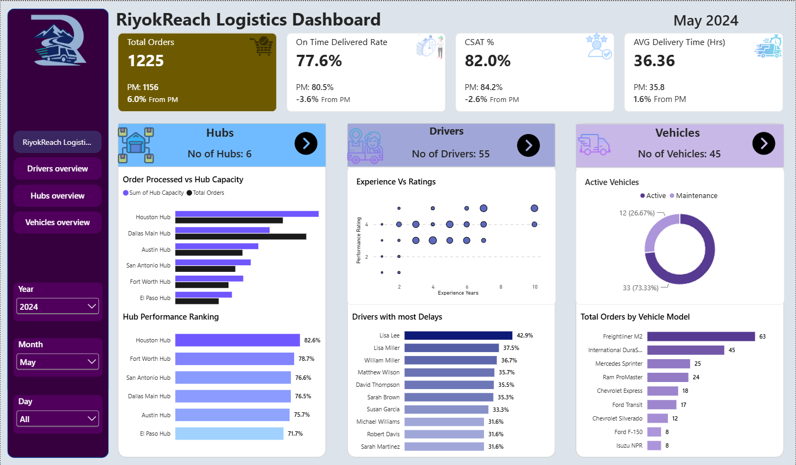
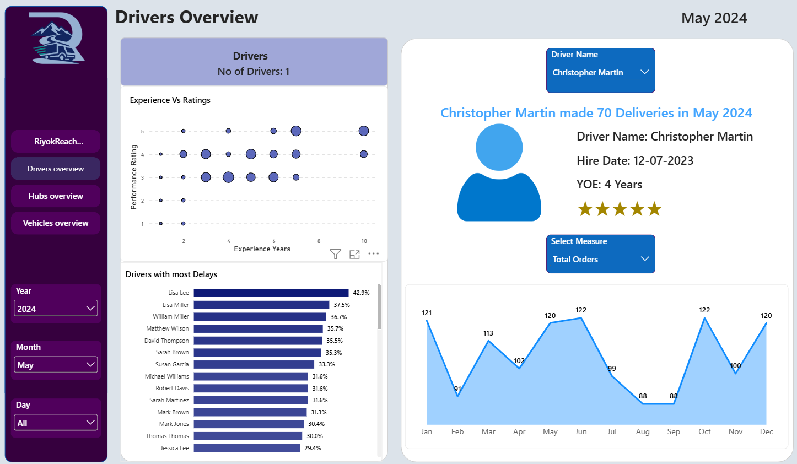

# 🚚 RiyokReach Logistics – Power BI Dashboard

## 📌 About the Project

I created this Power BI dashboard to understand how a logistics business performs in terms of order deliveries, driver performance, hub capacity, and vehicle usage.

While working on this project, I wanted to go beyond creating basic charts. I explored how different parts of a logistics business can be connected through data and presented in a way that makes the information easier to understand.

This project gave me hands-on experience with Power BI, from data modeling and DAX measures to interactive dashboards, navigation buttons, icons, images, and report design.

## 🎯 Project Objectives

The main goal was to build an interactive dashboard that helps users:

- Track total orders and key delivery performance indicators.
- Monitor on-time delivery rates, customer satisfaction, and average delivery time.
- Compare hub capacity with the number of orders processed.
- Analyze driver experience, performance ratings, and delivery delays.
- Understand vehicle activity, maintenance status, and orders by vehicle model.
- Explore the data using interactive filters and page navigation.

## 🛠️ Tools & Technologies

- **Power BI Desktop** – Dashboard development and data visualization.
- **Power Query** – Data preparation and transformation.
- **DAX** – Creating measures and calculating performance metrics.
- **Data Modeling** – Building relationships between tables.
- **Interactive Visuals** – Charts, slicers, buttons, icons, and images.

## 📊 Dashboard Preview

### 1. Main Dashboard

The main dashboard provides a quick overview of the logistics business. It displays important KPIs, including total orders, on-time delivery rate, customer satisfaction, and average delivery time.

I also added summaries of hubs, drivers, and vehicles so users can get an overall picture of operations without having to open every report page.

### 2. Drivers Overview

This page focuses on driver performance and delivery activity. It includes an experience-versus-rating scatter chart, a ranking of drivers with the most delivery delays, and a monthly trend chart.

I also added a driver selection option so users can explore individual driver details, such as hire date, years of experience, and performance information.

### 3. Hubs Overview

The hubs page helps compare order volume with hub capacity and shows how different hubs perform against one another.

It includes hub performance rankings and a day-wise visual comparison of order-processing time. This makes it easier to spot differences between hubs and identify areas that may need attention.

### 4. Vehicles Overview

The vehicles page focuses on vehicle activity and order distribution across different vehicle models.

It helps users understand how many vehicles are active or under maintenance and which vehicle models handle the most orders. This information can support better decisions about vehicle utilization and maintenance planning.

### 5. Data Model & Table Relationships

One of the most useful parts of this project was working on the data model. I connected the Drivers, Hubs, Vehicles, Orders, and Date Table to create a structure that supports analysis across different business areas.

I also explored how relationships between tables affect filters and visual interactions. Keeping the model organized made it easier to build measures and create reports that respond to user selections.

## 📈 Key Metrics

The dashboard includes several important logistics performance indicators:

| Metric | What It Shows |
|---|---|
| Total Orders | The overall number of orders in the selected period |
| On-Time Delivery Rate | The percentage of orders delivered on time |
| Customer Satisfaction (CSAT) | The customer satisfaction level |
| Average Delivery Time | The average time taken to complete deliveries |
| Hub Capacity | The processing capacity of individual hubs |
| Hub Performance | A comparison of performance across hubs |
| Driver Performance | Driver experience, ratings, and delivery delays |
| Vehicle Utilization | Active vehicles, maintenance status, and orders by model |

*The displayed values depend on the selected filters and reporting period.*

## 📚 What I Learned

This project helped me improve my Power BI skills through practical implementation rather than just following individual tutorials.

Here are some of the things I worked on:

- **Data Modeling:** Creating relationships between multiple tables and understanding how those relationships affect report results.
- **DAX Measures:** Working with calculations for KPIs, delivery performance, order counts, and other business metrics.
- **Interactive Navigation:** Using buttons to move between the main dashboard and detailed report pages.
- **Dynamic Filtering:** Adding year, month, and day slicers to explore data for different periods.
- **Visual Design:** Using charts, cards, colors, icons, and images to make the report easier to read.
- **Drill-Down Analysis:** Creating dedicated pages for drivers, hubs, and vehicles instead of putting every detail on one screen.
- **Visual Formatting:** Adjusting layouts, spacing, labels, and colors to maintain a consistent look across the report.
- **Business Analysis:** Understanding how delivery delays, hub capacity, driver performance, and vehicle utilization can be examined together.

I particularly enjoyed learning how to make the report interactive. Instead of simply displaying numbers, I wanted users to be able to navigate between pages and explore the information that matters to them.

## 💡 Key Takeaways

Building this dashboard taught me that a good Power BI report is about more than choosing the right charts. The data model, calculations, layout, and user experience all play an important role.

I also gained a better understanding of how logistics data can be turned into useful insights for monitoring operations and identifying possible performance improvements.

I'm continuing to build my skills in data analytics by working on practical projects using tools such as Power BI, SQL, Excel, and Python.

This project is another step in learning how to transform raw business data into clear, interactive reports that help people understand performance and make informed decisions.

Thanks for checking out my project! Feedback and suggestions are always welcome.
